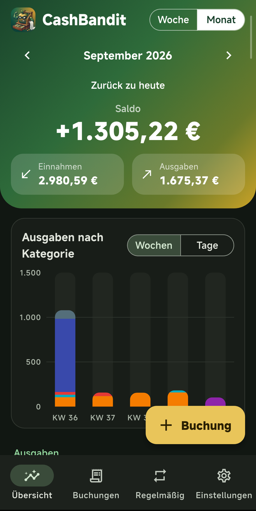
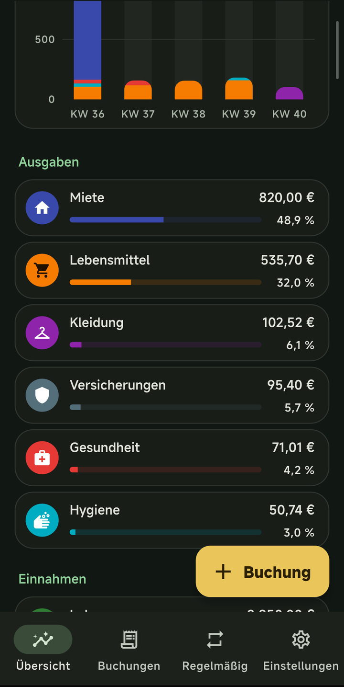
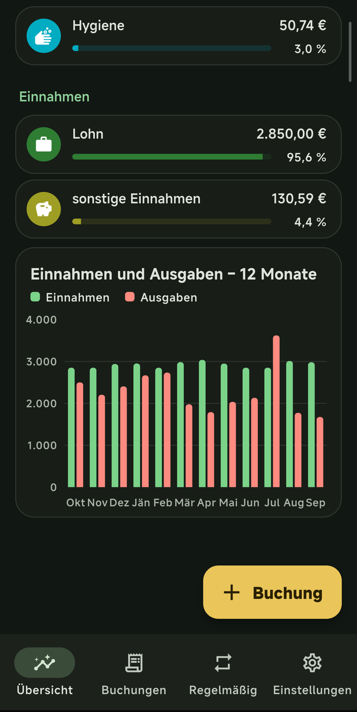
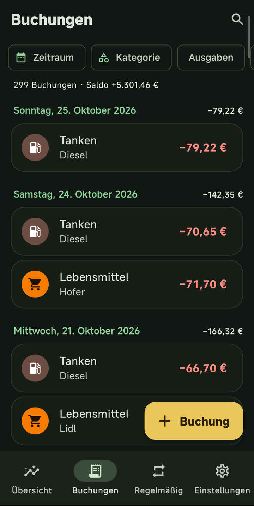
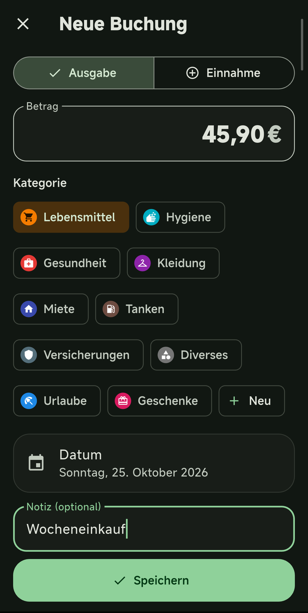
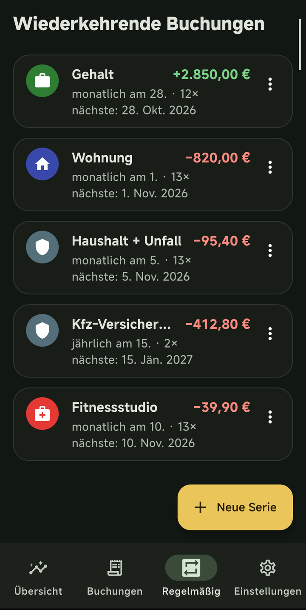
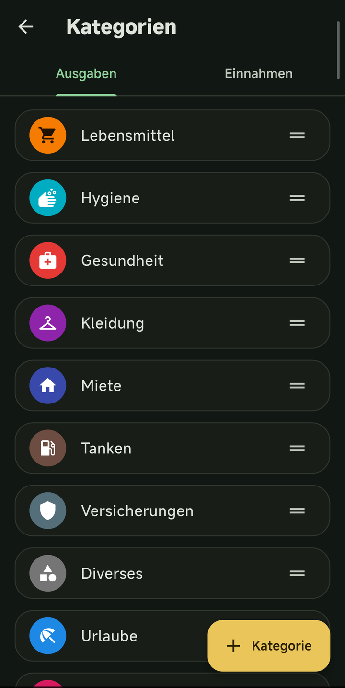
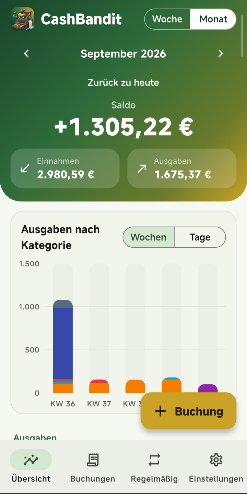
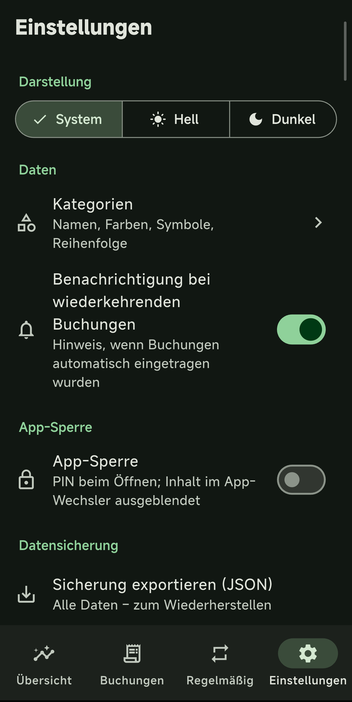

<p align="center">
  
</p>

<h1 align="center">CashBandit</h1>

<p align="center">
  <b>Offline-Kassabuch für Android</b> · <i>Offline cash book for Android</i><br>
  100 % offline · keine Tracker · kein Konto · GPL-3.0
</p>

[Deutsch](#deutsch) · [English](#english)

---

## Deutsch

CashBandit ist ein buntes, einfaches Kassabuch: Einnahmen und Ausgaben erfassen, nach Kategorien auswerten, wiederkehrende Buchungen automatisch eintragen lassen.

> **100 % offline, keine Tracker.** Die App hat **keine Internet-Berechtigung**, kein Login, keine Cloud, keine Analytics, kein Firebase und keine Google-Play-Dienste. Alle Daten liegen lokal in einer SQLite-Datenbank auf dem Handy.

### Funktionen

- **Kassabuch** – Einnahmen und Ausgaben mit Betrag (1.234,56 €), Datum, Kategorie und Notiz; bearbeiten, löschen mit „Rückgängig“
- **Kategorien** – 12 Standardkategorien mit eigenen Farben und Symbolen; alle bearbeitbar (Name, Farbe, Symbol, Typ), neue anlegen, per Drag & Drop sortieren; beim Löschen werden Buchungen auf eine Ersatzkategorie verschoben – keine Datenverluste
- **Übersicht** – Woche oder Monat mit Blättern; Saldo, Einnahmen, Ausgaben; gestapelte Balken nach Kategoriefarben (Woche: pro Tag; Monat: pro Woche oder Tag); Einnahmen vs. Ausgaben der letzten 12 Monate; Aufschlüsselung nach Kategorie mit Anteil in %; Tippen öffnet die Buchungen der Kategorie
- **Buchungsliste** – nach Tagen gruppiert; Filter nach Zeitraum, Kategorie, Typ; Suche in Notizen
- **Wiederkehrende Buchungen** – wöchentlich, monatlich (mit Tag im Monat; „31.“ wird in kürzeren Monaten zum letzten Tag), vierteljährlich, halbjährlich, jährlich; optional mit Enddatum oder Anzahl; fällige Buchungen werden beim Öffnen der App nachgetragen, ohne Duplikate; pausieren, bearbeiten (gilt nur für die Zukunft), löschen; optionale Benachrichtigung
- **App-Sperre** – PIN (4–6 Stellen, nur als PBKDF2-Hash gespeichert) und Fingerabdruck; Sperre beim Start und nach 0/1/5 Minuten im Hintergrund; Inhalt im App-Wechsler ausgeblendet
- **Datensicherung** – Export der ganzen Datenbank als JSON, Buchungen als CSV (Semikolon, Dezimalkomma); Import aus JSON (ersetzt alle Daten, mit Warnung)
- **Design** – Material 3, Hell- und Dunkelmodus (System oder manuell), komplett deutsche Oberfläche

### Screenshots

<p align="center">
  
  
  
</p>
<p align="center">
  
  
  
</p>
<p align="center">
  
  
  
</p>

<sub>Screenshots mit Beispieldaten.</sub>

### Bauen

Voraussetzungen: Flutter **3.47.7** (stable), JDK 17, Android SDK; `clang` für SQLite.

```sh
tools/fetch-sqlite.sh                 # SQLite-Quellcode (wird kompiliert, kein Fremd-Binary)
flutter pub get
dart run build_runner build -d        # Drift-Code (lib/data/db.g.dart)
flutter test
flutter build apk --release           # oder --split-per-abi
```

Die APK liegt danach unter `build/app/outputs/flutter-apk/`. Ohne Keystore wird sie unsigniert gebaut; zum Signieren siehe [docs/RELEASE.md](docs/RELEASE.md).

### Datenschutz

Keine Internet-Berechtigung (im Release-Manifest ausdrücklich entfernt), keine Werbung, keine Tracker, keine Analytics. Android-Cloud-Backup ist abgeschaltet; Daten wandern nur über die eigene JSON-Sicherung auf ein neues Gerät.

### Lizenz

[GPL-3.0](LICENSE) © CrashBandit82

---

## English

CashBandit is a colorful, simple cash book: record income and expenses, analyze them by category and let recurring bookings fill themselves in. The user interface is in German.

> **100 % offline, no trackers.** The app has **no internet permission**, no login, no cloud, no analytics, no Firebase and no Google Play services. All data is stored locally in an SQLite database on the phone.

### Features

- **Cash book** – income and expenses with amount, date, category and note; edit, delete with undo
- **Categories** – 12 default categories with their own colors and icons; all editable (name, color, icon, type), add new ones, reorder by drag & drop; deleting moves bookings to a replacement category – no data loss
- **Overview** – week or month with navigation; balance, income, expenses; stacked bars in category colors (week: per day; month: per week or day); income vs. expenses of the last 12 months; breakdown by category with percentage
- **Booking list** – grouped by day; filter by period, category, type; search in notes
- **Recurring bookings** – weekly, monthly (day of month; the 31st becomes the last day of shorter months), quarterly, half-yearly, yearly; optional end date or count; due bookings are filled in when the app opens, never twice; pause, edit (future only), delete; optional notification
- **App lock** – PIN (4–6 digits, stored only as a PBKDF2 hash) and fingerprint; locks on start and after 0/1/5 minutes in the background; content hidden in the app switcher
- **Backup** – whole database as JSON, bookings as CSV; import from JSON (replaces all data, with a warning)
- **Design** – Material 3, light and dark mode

### Screenshots

<p align="center">
  
  
  
</p>
<p align="center">
  
  
  
</p>
<p align="center">
  
  
  
</p>

<sub>Screenshots with sample data.</sub>

### Build

Requirements: Flutter **3.47.7** (stable), JDK 17, Android SDK; `clang` for SQLite.

```sh
tools/fetch-sqlite.sh
flutter pub get
dart run build_runner build -d
flutter test
flutter build apk --release
```

Signing: see [docs/RELEASE.md](docs/RELEASE.md) (German).

### License

[GPL-3.0](LICENSE) © CrashBandit82
